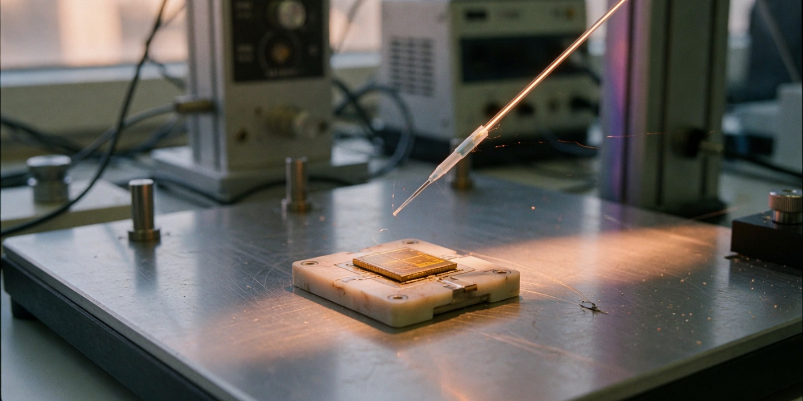

# life-tables-for-lasers

Telecom already has a life table for a laser in a cooled hut. A co-packaged laser lives beside a hot processor, and that table has not been written.

This program shifts a hut life table with an Arrhenius factor, then prices three screens on the same ten-laser lot. It does not extrapolate past the last telecom age. The drift limit is the highest drift among calibration parts that survived. Lot failures are the grade after the decision. They do not set the limit. The run is offline and deterministic. Kelvin in the fixture uses 0°C = 273 K, so 313 K is 40°C and 378 K is 105°C.

**hut-table** scraps a die when its telecom MTTF is under the warranty. A part that passes and then dies on the socket costs package surgery.

**hot-screen** scraps a die when a short hot-drift read is above the calibration limit. It does not consult the hut MTTF.

**both-gates** scraps a die when either gate says so.

## Run

From the repo root. Python 3.11 or newer. No install and no API key.

```bash
python3 -m life_tables_for_lasers fixtures/lot.json
python3 -m life_tables_for_lasers --verbose fixtures/lot.json
python3 -m life_tables_for_lasers --json fixtures/lot.json
python3 -m unittest discover -s tests -v
```

## Result

```
program laser-socket-105c  warranty 40000 h  hut 313 K  socket 378 K  Ea 0.40 eV
AF 12.81  hut table ends 160000 h = 12491 h at the socket (survive 70%)
40000 h at the socket needs 512357 h of hut life, past the table
naive hut read at 40000 h is 94%

 age_hut_h  survive_pct  age_socket_h
----------  -----------  ------------
         0          100             0
     10000           99           781
     20000           97          1561
     40000           94          3123
     80000           86          6246
    160000           70         12491

drift limit 30 ppm from 4 calibration survivors

policy      die_scrap  escapes  false_scrap  cost_usd
----------  ---------  -------  -----------  --------
hut-table           3        3            1     10740
hot-screen          5        1            1      3900
both-gates          6        1            2      3980

hot-screen costs USD 3900 on laser-socket-105c (1 escape, 1 false scrap); hut-table costs USD 10740 (3 escapes, 1 false scrap); both-gates costs USD 3980 and still misses the overlap escape.
```

At 0.40 eV the socket is 12.81 times the hut. The last telecom point, 160000 h and 70% survival, is only 12491 h beside the processor. A naive read of the hut table at the 40000 h warranty still says 94%. That warranty is 512357 h of hut life, past the table.

On the lot, the hut gate lets three failures bond (USD 10740, including one good die it scraps). The 30 ppm hot screen costs USD 3900: one overlap escape at 28 ppm, and one good die at 35 ppm. Requiring both gates does not catch that escape and adds the hut's false scrap, so it costs USD 3980.

| Screen | What it uses | Escapes | Cost |
|---|---|---|---|
| hut-table | telecom MTTF against 40000 h | 3 | USD 10740 |
| hot-screen | drift above 30 ppm | 1 | USD 3900 |
| both-gates | either gate | 1 | USD 3980 |

Die scrap is USD 80. A bonded failure is USD 3500. Prices are the fixture.

## Fixture shape

`fails` is the socket outcome, used only to score a decision. `split` is `cal` or `lot`.

```json
{"id": "p9", "split": "lot", "mttf_h": 60000, "drift_ppm": 28, "fails": true}
```

p9 passes both gates and still dies. That is the overlap the hut table does not price.

## License

MIT
